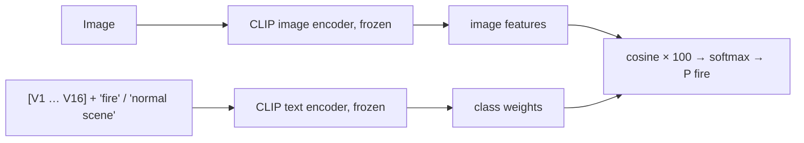

# Fire classification with CLIP + prompt tuning (CoOp)

Classifies images, or YOLO fire crops, as **fire** vs. **not fire** with a frozen [OpenCLIP](https://github.com/mlfoundations/open_clip) ViT-B-32. It is meant as a stage-2 verifier behind a YOLO fire detector.

Only the **prompt context** is trained, following CoOp ([Zhou et al., 2022](https://arxiv.org/abs/2109.01134)). The learnable vectors are token embeddings placed before the class name, and the whole prompt runs through CLIP's text encoder:



## Files
| File | Purpose |
|---|---|
| `clip_fire.py` | Shared code: CLIP loading, prompt learner, feature extraction, checkpoint I/O, metrics |
| `train_clip_fire.py` | Trains the prompts. Saves `learned_prompts_coop.pth` with the best val epoch and a threshold for 99% fire recall |
| `predict_clip_fire.py` | P(fire) for a folder and, when labels are given, a report: confusion matrix, ROC-AUC, AP, recall/rejection at the threshold |
| `learned_prompts.pth` | **Legacy** checkpoint (2025-09), kept for comparison (see below) |

## Usage
```bash
pip install -r requirements.txt
```
```bash
python train_clip_fire.py --fire DATA/train/fire --not-fire DATA/train/non_fire
```
```bash
python predict_clip_fire.py --fire DATA/test/fire --not-fire DATA/test/non_fire
```
```bash
python predict_clip_fire.py --images SOME/FOLDER
```
- Folders are searched recursively.
- The paths can also come from `.env`: `TRAIN_FIRE_PATH`, `TRAIN_NONFIRE_PATH`, `TEST_FIRE_PATH`, `TEST_NONFIRE_PATH`.
- `--help` lists every option. Useful ones:
  - `--ctx-init "a photo of a"`: start the context from these words instead of random noise.
  - `--csc`: one context per class instead of one shared context.
  - `--n-ctx`: number of context tokens.
  - `--resize-mode`: how the image is squared before CLIP.
  - `--target-recall`: fire recall the stored threshold is chosen for.

Training caches the CLIP image features once, so each epoch takes seconds.

## Design choices
- **Preprocessing:**
  - Default `--resize-mode longest`: pad to a square, then resize, so nothing is cut off. CLIP's default (`shortest`) center-crops, which cuts the edges off wide crops.
  - The mode is stored in the checkpoint, so prediction always matches training.
- **QuickGELU:** OpenAI's weights expect QuickGELU, but open_clip's `ViT-B-32` config uses GELU. New checkpoints force QuickGELU when `pretrained=openai`.
- **Class text:** `fire` vs. `normal scene`. CLIP handles negations like "non fire" badly. Change it with `--class-names`.
- **Split:** the validation split is stratified and seeded. It is **per image**, so frames from the same video can land in both train and val. Evaluate on a test set from different videos or cameras.
- **Checkpoint:** keeps the epoch with the lowest val loss. It stores the P(fire) threshold that keeps `--target-recall` (default 99%) of the val fire images, along with the full config.

## Legacy checkpoint (`learned_prompts.pth`)
The original 2025 version was **not real prompt tuning**.
- Its learned vectors were averaged with CLIP's text output *after* the encoder, which makes it a linear probe on CLIP image features.
- Its predict script combined the vectors with a different formula than training used. The classifier it evaluated was never the one that was trained.

`predict_clip_fire.py` still reads that checkpoint, using the formula it was **trained** with and its original setup: center-crop, no QuickGELU, threshold 0.5. Its README result (accuracy 0.9965 on 10,500 test images) cannot be reproduced, because the dataset is missing.
